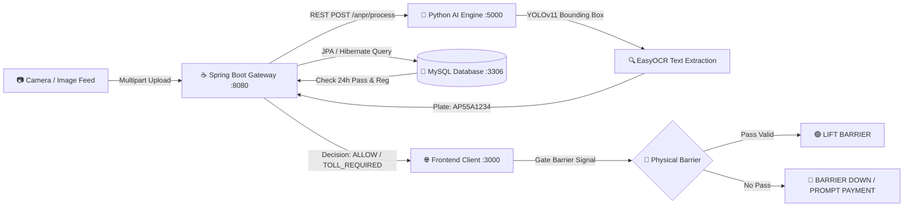

<div align="center">

# 🛣️ SmartToll AI
### Next-Gen AI-Powered Smart Toll & Automated Barrier Clearance System

[](https://www.oracle.com/java/)
[](https://spring.io/projects/spring-boot)
[](https://www.python.org/)
[](https://github.com/ultralytics/ultralytics)
[](https://www.mysql.com/)
[](https://getbootstrap.com/)
[](LICENSE)

<p align="center">
  <b>Skip the Queue. Keep Moving.</b><br>
  An end-to-end intelligent transportation solution combining Computer Vision, Machine Learning, and Enterprise Java to automate highway toll collection and barrier control in real-time.
</p>

[Key Features](#-key-features) • [Architecture](#-system-architecture) • [Project Structure](#-project-structure) • [Installation & Setup](#-installation--setup) • [API Documentation](#-api-endpoints)

</div>

---

## 📌 Problem & Overview

Traditional highway toll booths suffer from long queues, manual transaction delays, and traffic congestion. **SmartToll AI** modernizes toll collection by introducing a touchless, high-speed automated pipeline:

1. **Computer Vision Scanning**: As a vehicle approaches the plaza, high-definition camera feeds are analyzed by a custom-trained **YOLOv11** object detection model and **EasyOCR** engine to localize and extract the license plate in milliseconds.
2. **Ledger Cross-Referencing**: The Java Spring Boot gateway verifies if the detected plate is registered in the database and holds an active 24-hour prepaid toll pass for that specific plaza.
3. **Automated Barrier Control**: 
   - ✅ **Active Pass Found**: Barrier lifts immediately (`ALLOW`) for uninterrupted transit.
   - 🛑 **No Pass Found**: Barrier stays locked (`PAYMENT_REQUIRED`), prompting the operator/driver with an instant payment selection modal (UPI / Card / Cash / FASTag) to clear the vehicle.

---

## 🚀 Key Features

* **🎯 Custom YOLOv11 License Plate Detection**: Custom-trained neural network weights (`best.pt`) optimized for Indian vehicle license plate formats (e.g., `AP55A1234`).
* **🔍 Deep Optical Character Recognition (EasyOCR)**: Regex-filtered optical recognition ensuring clean alphanumeric extraction without noise.
* **🛡️ Enterprise Security & Role-Based Access Control (RBAC)**:
  * **Admin**: View system analytics, register toll gates, manage plazas and oversee cross-network revenue.
  * **Toll Operator**: Plaza-locked terminal interface with auto-detection of assigned toll rates and live barrier monitoring.
  * **Driver / Vehicle Owner**: Register vehicles, review travel history, and purchase 24-hour toll passes in advance.
* **💳 Multi-Method Simulated Payment Gateway**:
  * Realistic checkout interface supporting **UPI / QR**, **Credit/Debit Card (POS)**, **Cash at Booth**, and **FASTag / Net Banking**.
  * Auto-generates cryptographically distinct transaction IDs (`TXN...`) and timestamps.
* **🚦 Real-Time Barrier Simulator**:
  * Interactive UI visualizer showing dynamic barrier arm animations (OPEN / CLOSED).
  * HSEP Indian High Security Registration Plate (`IND`) visualization with hologram emblem.
* **⚡ Standalone Fallback Support**: If the Python service is offline, the Spring Boot engine provides an intelligent fallback so the web portal remains fully operable.

---

## 🏗️ System Architecture



---

## 📂 Project Structure

```text
smarttoll-ai/
│
├── frontend/                        # Client-Side Application
│   ├── css/
│   │   └── style.css                # Custom UI themes, gradients, barrier animations
│   ├── js/
│   │   ├── api.js                   # Fetch API service layer & JWT bearer interceptor
│   │   └── app.js                   # Session auth guard & dynamic navbar
│   ├── pages/
│   │   ├── anpr.html                # Live AI ANPR Simulator & Barrier Hub
│   │   ├── dashboard.html           # Role-based metrics, analytics, quick stats
│   │   ├── login.html               # User / Driver Authentication
│   │   ├── operator-login.html      # Toll Gate Plaza Operator Login
│   │   ├── register.html            # User self-registration
│   │   ├── tolls.html               # Plaza grid & advance pass purchase
│   │   ├── vehicles.html            # Vehicle registration & garage management
│   │   └── payments.html            # Verifiable digital pass ledger
│   └── index.html                   # Modern landing page & feature overview
│
├── smartToll/                       # Spring Boot Enterprise Backend
│   ├── src/main/java/com/smartToll/
│   │   ├── ai/anpr/                 # ANPR proxy controller & verification services
│   │   ├── config/                  # SecurityConfig (JWT filter, CORS, WebMvc)
│   │   ├── controller/              # REST Controllers (User, Vehicle, Toll, Payment)
│   │   ├── entity/                  # JPA Entities (User, Vehicle, Toll, TollPayment)
│   │   ├── jwt/                     # JWT token generator, validator, auth filter
│   │   ├── repository/              # Spring Data JPA Repositories
│   │   └── service/                 # Business logic interfaces & implementations
│   ├── src/main/resources/
│   │   └── application.properties   # Database connections & multipart configurations
│   ├── pom.xml                      # Maven dependencies
│   └── mvnw.cmd                     # Maven wrapper
│
└── SmartToll-AI/                    # Python Computer Vision Microservice
    ├── images/                      # Sample vehicle test images (car.jpg, car1.jpg)
    ├── runs/detect/smarttoll_test/
    │   └── weights/best.pt          # Custom trained YOLOv11 neural network weights
    ├── app.py                       # Flask inference API (/anpr/process)
    └── requirements.txt             # PyTorch, Ultralytics, EasyOCR, OpenCV dependencies
```

---

## 🛠️ Installation & Setup

### Prerequisites
* **Java Development Kit (JDK 21+)**
* **Python 3.10+** (with pip)
* **MySQL Server 8.0+** (or TiDB Cloud)
* **Git**

---

### 1. Clone the Repository
```bash
git clone https://github.com/prasad463-a/smarttoll-ai.git
cd smarttoll-ai
```

---

### 2. Database Configuration
By default, the application connects to a MySQL database named `SmartToll_database`. 

Make sure MySQL is running on port `3306` (or update `smartToll/src/main/resources/application.properties` with your credentials):
```properties
spring.datasource.url=jdbc:mysql://localhost:3306/SmartToll_database?createDatabaseIfNotExist=true
spring.datasource.username=root
spring.datasource.password=root
```
*(Spring Boot automatically generates all tables upon startup).*

---

### 3. Start Python AI Microservice (Terminal 1)
```bash
cd SmartToll-AI
pip install -r requirements.txt
python app.py
```
* **Runs at**: `http://localhost:5000`

---

### 4. Start Spring Boot Backend (Terminal 2)
```bash
cd smartToll
./mvnw spring-boot:run
```
*(On Windows PowerShell, use `.\mvnw.cmd spring-boot:run`)*
* **Runs at**: `http://localhost:8080`

---

### 5. Launch Frontend (Terminal 3)
```bash
cd frontend
python -m http.server 3000
```
* **Open in Browser**: 👉 **[http://localhost:3000](http://localhost:3000)**
*(Or right-click `frontend/index.html` in VS Code and select "Open with Live Server").*

---

## 📋 API Endpoints

| Method | Endpoint | Access | Description |
| :---: | :--- | :---: | :--- |
| `POST` | `/user/register` | Public | Register a new driver/user |
| `POST` | `/user/login` | Public | Authenticate user & return JWT Token |
| `POST` | `/toll/login` | Public | Authenticate toll plaza operator |
| `POST` | `/toll/add` | Public / Admin | Register a new toll gate |
| `GET` | `/toll/getall` | Authenticated | Retrieve all registered toll gates |
| `POST` | `/vehicle/add` | User / Admin | Register vehicle under account |
| `GET` | `/vehicle/getall` | User / Admin | Fetch vehicles (filtered by user role) |
| `GET` | `/vehicle/number/{plate}` | Authenticated | Lookup vehicle details by plate string |
| `POST` | `/payment/add` | Authenticated | Issue 24-hour prepaid toll pass |
| `GET` | `/payment/getall` | Authenticated | Fetch transaction records |
| `POST` | `/anpr/process` | Authenticated | Multipart image upload for AI plate recognition & gate clearance |

---

## 🧪 Demonstration Flow

1. **User Registration**: Create an account at `http://localhost:3000/pages/register.html`.
2. **Vehicle Registration**: Add vehicle number **`AP55A1234`** under your profile.
3. **Advance Pass (Optional)**: In **Tolls**, purchase a 24-hr pass for a plaza using UPI or Card.
4. **ANPR Scanner**:
   - Go to **ANPR Simulator** (`pages/anpr.html`).
   - Upload `SmartToll-AI/images/car.jpg`.
   - Click **Run AI Plate Recognition**.
   - If an active pass exists ➔ **Barrier Lifts (ALLOW)**.
   - If no pass exists ➔ Barrier remains locked; click **Pay Toll & Open Barrier**, select payment mode, and watch the gate open upon confirmation!

---

## 📄 License

This project is open-source and distributed under the **MIT License**.

---

<div align="center">
  <sub>Developed with ❤️ for Intelligent Transportation Systems.</sub>
</div>
